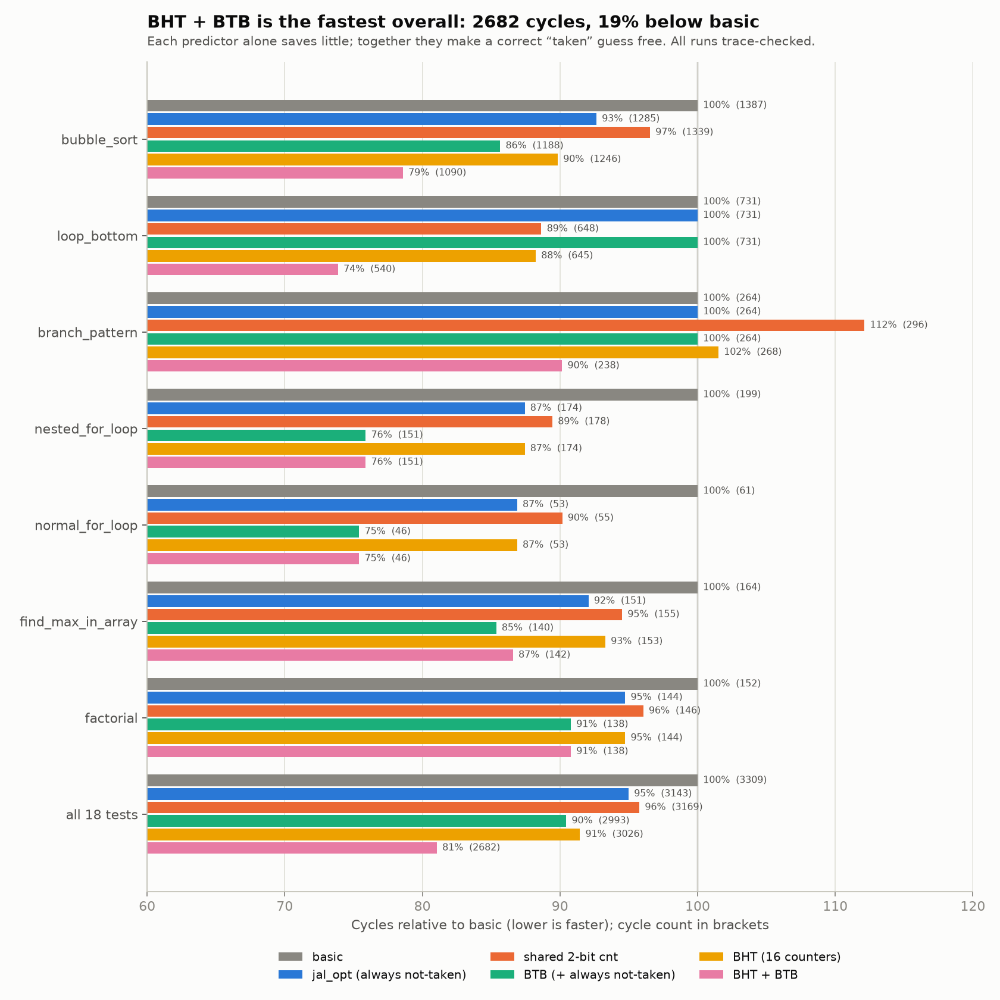

# Phase 1 + 2 report: checked testbench and branch predictor

Date: 2026-10-25 · CPU: `opt` (`src/cpu`) · Simulator: Verilator 5.041

## Summary

- **The testbench now checks every instruction**, not just `x31 == 666`. Each run is compared, instruction by
  instruction, against a Python reference model.
- **The original 2-bit counter has no bug.** It was slow for two reasons: the tests have mostly not-taken branches,
  and one counter is shared by every branch.
- **The new predictor (per-branch counters + branch target buffer) is 15% faster than no prediction** over all 18
  tests: 2682 vs 3143 cycles. Bubble sort CPI drops from 1.50 to 1.23.
- All 7 predictor configurations pass all 18 tests with matching traces (126 runs).
- Nothing from Phase 1–2 is committed yet. Only the earlier `$readmemh` path fix is committed (`a1af9fd`).

---

## Phase 0: Housekeeping

| Change | Why |
|---|---|
| `$readmemh` paths → `tb/...` (committed `a1af9fd`) | They pointed into other checkouts, so tests silently ran other programs. |
| `tb/tb_chip.sv`: `initial sys_clk = 0;` | `sys_clk` stayed X forever. Phase 3 needs it. |
| `makefile`: removed `sim_alu` | It pointed at `src/cpu/EX/tb_alu.v`, which doesn't exist. |
| `.gitignore`: `obj_dir/`, `sim_out*/`, `*.vcd` | The old `./obj_dir` style patterns don't work in git. |
| `README.md` | Fixed `run_all.sh` → `run_all_tb.sh`, `tb/hexa/` → `tb/hexas/`, the `https://https://` typo, and documented the new options. |

---

## Phase 1: A testbench that checks every instruction

### How it works

```
tb/hexas/test_X.mem ──► tb/iss/rv32_iss.py ──► iss_commit.log, iss_store.log ─┐
                                                                               ├─► tb/iss/compare_trace.py ─► MATCH / first mismatch
tb/hexas/test_X.mem ──► obj_dir/Vtb_chip  ──► rtl_commit.log, rtl_store.log ─┘
```

- **Reference model** (`tb/iss/rv32_iss.py`): pure Python, RV32IM, no toolchain needed. It models this machine:
  separate instruction and data memories both starting at 0, data memory loaded from `tb/word_data.mem`,
  registers reset to `x[i] = 3*i` (as `regfile` `INIT_STYLE=1` does).
- **RTL traces** (`tb/tb_chip.sv`):
  - Commit trace: one line `pc inst rd value` for each instruction that reaches WB. The PC is taken as
    `PC_plus_4_MEM_WB_o − 4`, so no RTL change was needed.
  - Store trace: one line `addr data strobe` for each data memory write.
  - Output files are set with `+commit=` and `+stores=`.
- **Performance counters** are printed at the end of every run:
  ```
  PERF cycles=1090 instret=890 cpi=1.225 redirect2=46 stall=99 redirect1=6
  PERF_BRANCH branches=292 taken=93 mispredict=44 jalr=2 jal_redirect=6 btb_redirect=182
  ```
  `redirect2` counts 2-cycle flushes (mispredict or `jalr`), `stall` counts load-use stalls, and `redirect1` counts
  1-cycle ID redirects. `PERF_BRANCH` is only printed for `opt`.
- **Runner** (`run_all_tb.sh`): a test passes only if the program reaches 666 **and** both traces match. It
  prints cycles and CPI, shows the first mismatching instruction on a failure, and puts `tb/word_inst.mem` back
  at the end.

### What it caught right away

On `train_fix_forward_bug` (the intentionally buggy version), `test_LOAD` used to count as a pass. The trace
shows the bug:

```
TRACE MISMATCH in commit trace at entry 11
  > reference 0000002c 0010a183 03 deadbeef
  > rtl       0000002c 0010a183 03 deadb6f0
```

### New tests

Both tests check their own results; the reference model passes both.

| Test | What it exercises |
|---|---|
| `test_loop_bottom` | do-while loops with the branch at the bottom (taken 110 of 123 times) and an array loop with `sw`/`lw`. This is the case prediction should help. |
| `test_branch_pattern` | three branches with different habits in one loop: alternating T/NT, never taken (placed right after the first), and a mostly-taken loop branch. |

---

## Phase 2: Branch predictor

### Step 1: is the original counter buggy?

Suspicion: `fix_predict_EX` compares the result with the counter's *current* value, not the guess made in ID, so
two back-to-back branches might see different values.

Test: a monitor recorded the real ID guess of every branch and compared it with what EX assumed.

| Program | Branches compared | Disagreements |
|---|---|---|
| all 16 original tests | all | 0 |
| bubble_sort (current) | 292 | 0 |
| bubble_sort from `595e410` and `5b504fb` (back-to-back `beq`/`blt`) | 273 | 0 |

**Conclusion: there is no bug.** The counter only crosses the taken / not-taken line after a mispredict, and a
mispredict always flushes the next branch out of ID before it reaches EX. So a stale value can never change a guess.

### Step 2: why it was slow

1. **Tests:** loops branch forward to exit and use `jal` to go back, so only 93 of 292 branches in bubble_sort
   are taken.
2. **One shared counter:** different branches keep overwriting it. In bubble_sort it mispredicts 115 times,
   more often than "always not taken" would (93).
3. **No target buffer:** a correct "taken" guess still loses 1 cycle, because the target is only known in ID. So
   prediction could save at most 1 cycle per taken branch.

### Step 3: what was built

```
           IF                         ID                              EX
PC ──► BTB lookup ──hit & taken──► (already redirected)          compare outcome
        │                          else: BHT guess ──taken──►      with carried guess
        └─ guess bit ──► IF/ID ──► guess bit ─────► ID/EX ──────► mismatch → 2-cycle fix
```

| Part | Detail |
|---|---|
| Direction predictor (`PRED`) | `static`: always not taken. `global`: one 2-bit counter. `bht` (default): 16 counters indexed by `PC[5:2]`. |
| Counter start value | Weakly **not** taken. Starting at weakly taken costs a 2-cycle mispredict the first time each branch runs. |
| BTB (`BTB=1`, default) | 16 entries, direct-mapped. Tags are the full PC, so a hit always means the same instruction. Filled in ID, where `PC + imm` is known. A hit on a `jal`, or on a branch the counter calls taken, fetches the target next cycle, so nothing is lost. |
| Guess carried down the pipe | The guess travels with the instruction (`btb_redirect` in IF/ID, `guess_taken` in ID/EX), so EX checks against what was actually guessed. With the BTB in IF there can now be more branches in flight, which makes this necessary. |
| Redirect priority | EX mispredict > EX `jalr` > ID `jal` > ID predicted-taken > IF BTB > PC+4 |
| Counter update | Only when `update_en` is set (tied to 1 for now). Phase 3 will use it to stop updates while the pipeline is frozen. |

Files: `src/cpu/branch_prediction.v` (rewritten), `src/cpu/cpu.v`, `src/cpu/IF_ID_pipeline.v`,
`src/cpu/ID_EX_pipeline.v`, `src/cpu/PC/PC_datapath.v`, `makefile`.

Usage:
```
make sim_chip CPU_VERSION=opt PRED=bht BTB=1
PRED=global BTB=0 ./run_all_tb.sh opt      # output goes to sim_out_opt_global_btb0/
```

### Step 4: results

Two sanity checks hold: `PRED=global BTB=0` with the old start value reproduces the old `opt` exactly
(1339, 296, …), and `PRED=static BTB=0` reproduces `jal_opt` exactly (1285, 264, …).



Cycles per test; bold marks the best in each row. `old_opt` is the code before this work. `global` is the same
shared counter with the new start value.

| Test | basic | jal_opt | old_opt | global | bht | static_btb | global_btb | bht_btb |
|---|---|---|---|---|---|---|---|---|
| bubble_sort | 1387 | 1285 | 1339 | 1337 | 1246 | 1188 | 1232 | **1090** |
| loop_bottom | 731 | 731 | 648 | 649 | 645 | 731 | 545 | **540** |
| branch_pattern | 264 | 264 | 296 | 297 | 268 | 264 | 267 | **238** |
| nested_for_loop | 199 | 174 | 178 | 176 | 174 | **151** | 153 | **151** |
| find_max_in_array | 164 | 151 | 155 | 151 | 153 | **140** | **140** | 142 |
| factorial | 152 | 144 | 146 | 144 | 144 | **138** | **138** | **138** |
| JAL_JALR | 152 | 144 | 146 | 144 | 144 | **138** | **138** | **138** |
| normal_for_loop | 61 | 53 | 55 | 53 | 53 | **46** | **46** | **46** |
| jal_then_beq | 33 | **31** | 34 | 33 | 33 | **31** | 33 | 33 |
| forward_normal | **28** | **28** | 30 | **28** | **28** | **28** | **28** | **28** |
| forward_malicious | **27** | **27** | 29 | **27** | **27** | **27** | **27** | **27** |
| load_then_use | **17** | **17** | 19 | **17** | **17** | **17** | **17** | **17** |
| 6 short tests (CAL_I, CAL_R, div_mod, LOAD, STORE, LUI_AUIPC) | same | same | same | same | same | same | same | same |
| **total** | 3309 | 3143 | 3169 | 3150 | 3026 | 2993 | 2858 | **2682** |

Mispredicts, shared counter vs per-branch counters:

| Test | global | bht |
|---|---|---|
| bubble_sort | 115 | 44 |
| branch_pattern | 48 | 34 |
| loop_bottom | 16 | 14 |

Bubble sort with BHT+BTB (`PERF` line): CPI 1.225 (was 1.504). The BTB steered the fetch 182 times, and only 6
`jal`s still needed the 1-cycle ID redirect (first sightings).

### Lessons (useful for interviews)

1. **The BHT and BTB help together far more than alone.** BHT alone −4%, BTB alone −5%, both −15%. The BTB
   removes the cost of `jal`, and only with the BTB does a correct "taken" guess become free. Without it, prediction
   saves at most 1 cycle per taken branch.
2. **The start value matters for code that runs once.** Starting at weakly-taken made `forward_*` tests 25% slower.
3. **A 2-bit counter can't learn alternation.** For an alternating T/NT branch starting at a weak state, the counter
   flips between the two weak states and is wrong every time. Learning it needs branch history (e.g. gshare). This
   is why `branch_pattern` still has 34 mispredicts in 81 branches.
4. **Measure before blaming the implementation.** The suspected bug didn't exist. The monitor and the reference
   trace settled it in minutes.

---

## Open issues

| Issue | Impact | Suggested action |
|---|---|---|
| The local `~/Desktop/popo_train_cpu/riscv-assembler` is older than the GitHub fork. It can't assemble `lb/lh/lbu/lhu` with `imm(reg)` syntax, so `compile_all_tb.py` fails on `test_bubble_sort.asm`. | New tests can't use byte/half loads. The committed hex files are fine. | `git -C ~/Desktop/popo_train_cpu/riscv-assembler pull` (auto mode blocked me from cloning it) |
| Alternating branches still mispredict | 34 / 81 in `branch_pattern` | Optional: gshare / local history predictor |
| `jalr` (function return) still costs 2 cycles | 18 cycles in `factorial` | Optional: return address stack |
| Load-use stall | 99 cycles in bubble_sort | Fundamental in a 5-stage pipeline; only reordering the code helps |
| Phase 1–2 not committed | — | Your call |

## Next step (Phase 3, not started)

Make the memory side real: I/D caches with tags, a pipeline that can stall in every stage on a miss, DMA moving
real cache lines, async FIFOs and AXI to a DRAM on `sys_clk`, with D-cache write-back and write-through both
available for comparison. The full plan is in `~/.claude/plans/starry-launching-catmull.md`.
